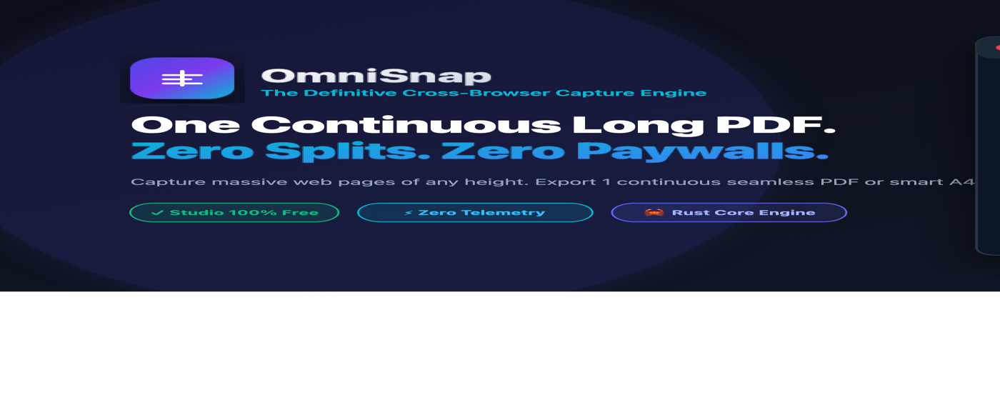

<p align="center">
  
</p>

# GhostShot — Next-Generation Full Page Screen Capture & Studio

> **100% Free • Zero Telemetry • 100% On-Device Processing • Cross-Browser**

GhostShot is a modern, high-performance browser extension for full-page screenshot capture, nested scroll container snapshots, and integrated client-side annotation studio. Built without subscription paywalls, third-party tracking, or cloud uploads.

[](https://chrome.google.com/webstore)
[](LICENSE)
[](extension/manifest.json)
[](PRIVACY.md)

---

## ✨ Features & Highlights

### 📸 4 Capture Modes
1. **Full Page Capture (`Alt+Shift+P` / `Option+Shift+P`)**:
   - Automated scrolling engine with dynamic DOM height detection.
   - Intelligent fixed/sticky element suppressor that hides floating headers during capture and restores them cleanly.
   - Multi-tile canvas architecture supporting 20,000+ px pages without browser canvas dimension crashes.
2. **Smart Scroll Container Snip**:
   - Detects nested scrollable `overflow: auto/scroll` containers (Notion tables, Slack threads, Twitter/X feeds, Linear boards, code editors).
   - Captures entire scroll container content independently from the main window.
3. **Interactive Region Selection (`Alt+Shift+S`)**:
   - Pixel-accurate crosshair selection tool.
4. **Instant Viewport (`Alt+Shift+V`)**:
   - 0ms instant snapshot of the visible browser screen.

### 🎨 Built-In Annotation Studio
- **Shapes & Tools**: Arrows, Rectangles, Circles, Highlighters, Freehand pen.
- **Auto-Incrementing Step Badges**: 1, 2, 3... indicators for QA bug reports and step-by-step guides.
- **Privacy Redaction**: Blur and Pixelate filters to hide confidential credentials, tokens, or PII before sharing.
- **Mockup Studio**: Wrap captures in macOS Dark/Light or Windows 11 window frames with gradient backdrops and drop shadows.
- **Crop & Rotate**: Non-destructive cropping tool.

### 📄 Smart PDF & Continuous Long Page Export
- **Single Continuous Long Page PDF**: Generates 1 seamless, un-split PDF matching the exact height of the web page.
- **Smart Multi-Page Split**: Breaks ultra-tall documents into standard A4, Letter, or Legal pages with link retention.
- **Lossless PNG / WebP / JPG**: Export directly or 1-click copy to system clipboard.

### 🔒 100% Local On-Device Privacy Guarantee
- No tracking pixels, analytics scripts, or remote server pings.
- All image stitching, editing, and PDF compilation run inside the local browser sandbox.
- Read our full [Privacy Policy](PRIVACY.md).

---

## 🗂️ Project Structure

```
GhostShot/
├── extension/                 # Production Extension Source Code
│   ├── manifest.json          # Chrome / Brave / Edge Manifest V3
│   ├── manifest.firefox.json  # Mozilla Firefox Manifest V2
│   ├── icons/                 # Extension Icons (16, 32, 48, 128, 512 px)
│   └── src/                   # Core Extension Modules
│       ├── background/        # Service worker & capture orchestration
│       ├── capture/           # Scroll stitcher, PDF engine, & viewer
│       ├── studio/            # Annotation studio & canvas drawing engine
│       ├── popup/             # Extension toolbar action popup
│       ├── options/           # Settings & configuration dashboard
│       └── lib/               # Bundled vendor libraries (jspdf, etc.)
├── store/                     # Chrome Web Store Graphic Assets & Listing Kit
│   ├── icon512.png            # 512x512 Store Master Icon
│   ├── promo_small_440x280.png# Small Promo Tile
│   ├── promo_large_920x680.png# Large Promo Tile
│   ├── promo_marquee_1400x560.png # Marquee Banner
│   ├── screenshot1_*.png      # 5 High-Resolution (1280x800) Store Screenshots
│   └── CHROME_WEB_STORE_LISTING.md # Official Store Copy & Justifications
├── design/                    # UI/UX Designs & FigCraft Master Files
│   ├── GhostShot_Store_Showcase.figcraft # Native FigCraft Project
│   └── ghostshot_design_artboard.html    # Standalone HTML Canvas Artboard
├── docs/                      # Technical Documentation
│   └── ARCHITECTURE.md
├── scripts/                   # Build & Automation Tooling
│   ├── package_browsers.sh    # Multi-browser packaging script
│   └── build_store_assets.py  # Automated asset generator
├── dist/                      # Ready-to-Install Distribution Bundles
│   ├── ghostshot-chrome-brave-edge.zip
│   ├── ghostshot-firefox.zip
│   └── ghostshot-safari.zip
└── PRIVACY.md                 # Official Public Privacy Policy
```

---

## 🚀 Installation & Local Development

### Load in Google Chrome / Brave / Microsoft Edge
1. Clone this repository:
   ```bash
   git clone https://github.com/GhostProtocolOps/ghostshot.git
   cd ghostshot
   ```
2. Open Chrome and navigate to `chrome://extensions`.
3. Enable **Developer mode** (top-right toggle).
4. Click **Load unpacked** and select the `extension/` directory.

### Build Multi-Browser Packages
To generate all release zip archives for Chrome, Firefox, and Safari:
```bash
bash scripts/package_browsers.sh
```
Output files will be generated in `dist/`.

---

## 📄 License

Distributed under the MIT License. See [LICENSE](LICENSE) for more information.
