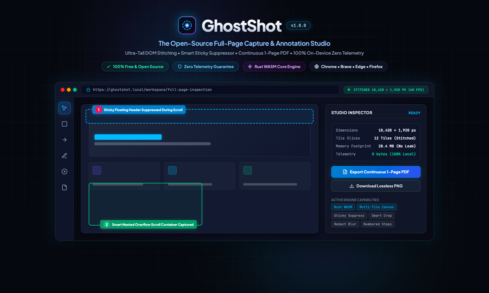

<p align="center">
  
</p>

<p align="center">
  <a href="#quickstart"><strong>Quickstart</strong></a> &middot;
  <a href="#why-ghostshot"><strong>Why GhostShot</strong></a> &middot;
  <a href="#features"><strong>Features</strong></a> &middot;
  <a href="#the-four-pillars"><strong>Four Pillars</strong></a> &middot;
  <a href="#capture-modes"><strong>Capture Modes</strong></a> &middot;
  <a href="#shortcuts"><strong>Shortcuts</strong></a> &middot;
  <a href="PRIVACY.md"><strong>Privacy Guarantee</strong></a>
</p>

<p align="center">
  <a href="https://chrome.google.com/webstore"></a>
  <a href="LICENSE"></a>
  
  
  
  <a href="https://github.com/GhostProtocolOps/ghostshot/stargazers"></a>
</p>

<br/>

# GhostShot is the browser capture & studio built for high performance and total privacy.

Open-source, ultra-tall scrolling capture and visual annotation studio.

**If other screenshot extensions are _cloud bloatware_, GhostShot is your _zero-telemetry power tool_.**

GhostShot is a high-performance browser extension for full-page scrolling screen capture, nested scroll container snapshots, and integrated client-side annotation studio. Built without subscription paywalls, blurred canvas dimension limits, third-party tracking, or cloud uploads.

It captures 20,000+ px pages in seconds using multi-tile canvas virtualization and high-speed Rust WASM stitching, suppresses floating sticky headers automatically, and exports continuous single-page PDFs or lossless PNGs directly to your local disk.

**Capture what matters, not subscription popups.**

|        | Step | Capability |
| ------ | ---- | ---------- |
| **01** | **Scroll & Suppress** | Automated DOM scrolling with intelligent sticky header detection & suppression. |
| **02** | **Annotate & Redact** | Pixel-accurate arrows, boxes, callouts, blur-redactions, and auto-incrementing step badges. |
| **03** | **Export Anywhere** | Instant lossless PNG, continuous 1-page PDF, or clipboard copy in 0ms. |

<br/>

<div align="center">
<table>
  <tr>
    <td align="center"><strong>Browser<br/>Support</strong></td>
    <td align="center" valign="top"><br/><sub>Google Chrome</sub></td>
    <td align="center" valign="top"><br/><sub>Brave</sub></td>
    <td align="center" valign="top"><br/><sub>Microsoft Edge</sub></td>
    <td align="center" valign="top"><br/><sub>Firefox</sub></td>
    <td align="center" valign="top"><br/><sub>Apple Safari</sub></td>
    <td align="center" valign="top"><br/><sub>Opera / Arc</sub></td>
  </tr>
</table>

<em>100% on-device. Zero telemetry. No account or cloud server required.</em>
</div>

<br/>

## GhostShot is right for you if

- ✅ You need to capture **ultra-tall (20,000+ px) webpages** without browser canvas dimension crashes
- ✅ You are tired of **sticky navigation bars duplicating** or covering content on every scroll slice
- ✅ You need to capture **nested scrollable containers** (Notion databases, Slack threads, Twitter feeds, Linear boards, code editors)
- ✅ You create **QA bug reports & documentation** and need auto-incrementing `①`, `②`, `③` step stamps
- ✅ You want a **continuous single-page PDF** document for design reviews without awkward page breaks cutting text in half
- ✅ You require **strict privacy (GDPR / HIPAA / SOC2 compliance)** with zero cloud telemetry or third-party tracking
- ✅ You refuse to pay **$15/month subscriptions** for basic browser screenshot functionality

<br/>

## The four pillars

Four technical pillars make GhostShot reliable across every website and browser engine:

| Pillar | Architecture | What it covers |
| --- | --- | --- |
| **Multi-Tile Virtual Canvas** — Infinite scroll without memory exhaustion. | Client Canvas 2D | Overcomes Chrome's 16,384px canvas dimension ceiling by sharding into a virtual tile grid with seamless coordinate projection. |
| **Dynamic Sticky Suppressor** — Clean, uninterrupted scroll captures. | DOM Mutation & Style Engine | Traverses computed styles for `position: fixed` and `position: sticky`, suppresses them during incremental scrolling, and cleanly restores state. |
| **Integrated Studio & Redaction** — Instant visual feedback & documentation. | Vector Annotation Layer | Pixel-perfect arrows, highlighters, geometric callouts, text captions, auto-increment step stamps, and GPU blur-redaction for PII. |
| **Continuous PDF & Zero-Cloud Pipeline** — 100% on-device delivery. | Local PDF Engine | Generates continuous 1-page vector PDFs or paginated documents without sending a single byte to an external server. |

<br/>

## Features

<table>
<tr>
<td align="center" width="33%">
<h3>📸 Full-Page Capture</h3>
Scrolls automatically through long articles, feeds, and dashboards with 60 FPS frame capture and multi-tile canvas stitching.
</td>
<td align="center" width="33%">
<h3>📦 Nested Container Snip</h3>
Hover over any scrollable element (Notion, Slack, Linear) to snapshot its entire overflow content independently.
</td>
<td align="center" width="33%">
<h3>✂️ Pixel-Perfect Crop</h3>
Crosshair precision region selection tool with instant coordinate readout, aspect ratio locks, and live magnifier.
</td>
</tr>
<tr>
<td align="center">
<h3>🎨 Annotation Studio</h3>
Highlighters, geometric shapes, arrows, text boxes, and auto-increment step badges for clear, professional QA reports.
</td>
<td align="center">
<h3>📄 Continuous 1-Page PDF</h3>
Export uninterrupted single-page PDFs or multi-page documents with custom margins and vector text rendering.
</td>
<td align="center">
<h3>🛡️ Zero Telemetry</h3>
100% on-device processing. No accounts, no background analytics, no cloud uploads, and zero tracking scripts.
</td>
</tr>
</table>

<br/>

## 📸 Capture Modes

### 1. Full Page Capture (`Alt+Shift+P` / `Option+Shift+P`)
* Automated scrolling engine with dynamic DOM height detection and frame settling.
* Intelligent fixed/sticky element suppressor that hides floating headers during capture and restores them cleanly.
* Multi-tile canvas architecture supporting 20,000+ px pages without browser canvas dimension crashes.

### 2. Smart Scroll Container Snip
* Detects nested scrollable `overflow: auto/scroll` containers (Notion tables, Slack threads, Twitter/X feeds, Linear boards, code editors).
* Captures entire scroll container content independently from the main window.

### 3. Interactive Region Selection (`Alt+Shift+S`)
* Pixel-accurate crosshair selection tool with live coordinate overlay and aspect-ratio locking.

### 4. Instant Viewport (`Alt+Shift+V`)
* 0ms instant snapshot of the visible browser screen without scrolling.

<br/>

## ⌨️ Shortcuts

| Shortcut | Action | Description |
| --- | --- | --- |
| <kbd>Alt</kbd> + <kbd>Shift</kbd> + <kbd>P</kbd> (Mac: <kbd>⌥</kbd> <kbd>⇧</kbd> <kbd>P</kbd>) | **Full Page Capture** | Scrolls and captures entire webpage height automatically |
| <kbd>Alt</kbd> + <kbd>Shift</kbd> + <kbd>S</kbd> (Mac: <kbd>⌥</kbd> <kbd>⇧</kbd> <kbd>S</kbd>) | **Selected Region** | Interactive crosshair selection for custom area capture |
| <kbd>Alt</kbd> + <kbd>Shift</kbd> + <kbd>V</kbd> (Mac: <kbd>⌥</kbd> <kbd>⇧</kbd> <kbd>V</kbd>) | **Instant Viewport** | 0ms snapshot of visible screen area |
| <kbd>Escape</kbd> | **Cancel** | Aborts active capture or region selection |

<br/>

## 🚀 Quickstart

### Chrome Web Store (Recommended)
GhostShot is currently pending review on the Chrome Web Store. Once approved, it can be installed with a single click.

### Developer Mode (Local Installation)

1. **Clone this repository**:
   ```bash
   git clone https://github.com/GhostProtocolOps/ghostshot.git
   cd ghostshot
   ```

2. **Open your browser extensions manager**:
   * Chrome / Brave: `chrome://extensions`
   * Microsoft Edge: `edge://extensions`
   * Arc: `arc://extensions`

3. **Enable Developer mode** toggle in the top-right corner.

4. **Click "Load unpacked"** and select the `dist/ghostshot-chromium` directory.

5. **Pin GhostShot to your toolbar** and hit `⌥⇧P` on any website!

<br/>

## 🛠️ Architecture & Core Engine

```
GhostShot/
├── extension/             # Manifest V3 Extension Source
│   ├── src/
│   │   ├── background/    # Service Worker (Capture coordination & lifecycle)
│   │   ├── capture/       # Multi-tile Canvas Stitching & Scroll Engine
│   │   ├── studio/        # Annotation Studio (Canvas 2D & Vector Callouts)
│   │   └── popup/         # HUD Action Controller
├── crates/
│   └── ghostshot-core/    # Rust Core Engine (Stitching algorithms & tests)
├── store/                 # Chrome Web Store Verified Assets
└── design/                # High-DPI Vector Showcase & UI Assets
```

### Building from Source

```bash
# Build browser extension packages (Chrome, Firefox, Safari)
bash scripts/package_browsers.sh

# Run Rust core engine tests
cargo test --manifest-path crates/ghostshot-core/Cargo.toml
```

<br/>

## 🛡️ Privacy Guarantee

GhostShot adheres to a strict **Zero-Telemetry Policy**:
* **No Cloud Servers**: GhostShot runs 100% locally on your computer inside your browser's sandboxed extension environment.
* **No Network Requests**: Captures are never transmitted, uploaded, or analyzed externally.
* **No Analytics**: We do not collect telemetry, crash reports, IP addresses, or browsing history.
* **Open Source**: Every line of code is inspectable in this repository.

Read our complete policy in [PRIVACY.md](PRIVACY.md).

<br/>

## 📄 License

GhostShot is open-source software licensed under the [MIT License](LICENSE).
