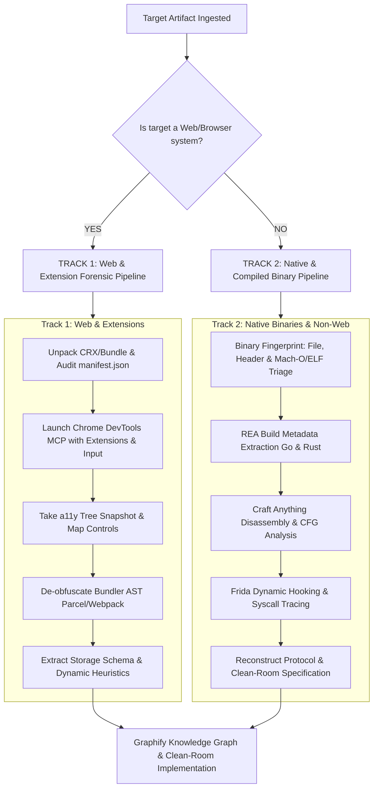

# Universal Reverse Engineering Playbook & Master Guide
## Multi-Engine Architecture: Chrome DevTools MCP, Craft Anything, REA & Knowledge Graphs

---

### Executive Overview

This playbook establishes the standard operating procedure for reverse-engineering software systems without source code. It unifies four specialized local infrastructure engines:
1. **Chrome DevTools MCP** (Managed Profile, Extensions & Input Automation): For web applications, browser extensions (MV2/MV3), webviews, and client-rendered SPAs.
2. **CRAFTAnything** (ArtCraft Reverse-Engineering Engine): 17 deep toolsets (`native`, `formats`, `apple`, `managed`, `android`, `java`, `runtime`, `frida`, `application`, etc.) for compiled binaries, memory snooping, decompilation, and format reconstruction.
3. **REA (Reverse Engineering Assistant)**: Forensic build metadata extraction for compiled Go and Rust binaries (`go_build_metadata`, `rust_build_metadata`), dependency trees, and compiler fingerprints.
4. **Graphify Knowledge Graph**: Persistent entity-relationship subgraphs mapping reverse-engineered architectural components, data flows, and god nodes.

---

### Dual-Track Operational Routing



---

## Part 1: Track 1 — Web Applications & Browser Extensions

### 1.1 Chrome DevTools MCP Setup
To inspect extensions and privileged browser contexts, the MCP server must be configured in `~/.gemini/config/mcp_config.json` with:
- `--categoryExtensions`: Permits navigating to `chrome-extension://` targets and exposes extension lifecycle APIs.
- `--experimentalDevtools`: Permits automated interaction with DevTools panels.
- `--categoryInput`: Enables high-precision keyboard and mouse gesture automation.
- `--experimentalIncludeAllPages`: Surfaces extension popups, background service workers, and offscreen documents in `list_pages`.

### 1.2 Step-by-Step Web Reverse Engineering Workflow

#### Step 1: Ingestion & Static Package Decomposition
1. Extract extension packages:
   ```bash
   unzip -q extension.crx -d unpacked-src/
   ```
2. Parse `manifest.json`:
   - Identify permissions (`activeTab`, `scripting`, `storage`, `unlimitedStorage`, `downloads`).
   - Identify background worker (`background.service_worker` or `background.scripts`).
   - Locate action entry points (`action.default_popup`, `options_page`, `web_accessible_resources`).

#### Step 2: Live Accessibility Mapping & Control Discovery
1. Call `chrome-devtools` `list_pages` to locate active contexts.
2. Target the results or popup page using `take_snapshot(pageId)`:
   - Extracts all interactive DOM elements with unique accessibility IDs (`uid`).
   - Prevents accidental triggering of destructive actions (e.g. Delete, Discard).
3. Sequentially probe controls:
   - Record control label, tooltip, and visual icon.
   - Dispatch `click(uid)`.
   - Observe whether transition occurs in the same tab (`window.location`) or creates a new window (`chrome.tabs.create`).

#### Step 3: Bundle De-Minification & Logic De-Obfuscation
1. Identify module loaders:
   - **Parcel**: Search for `parcelRequire` / `parcelRequire60cc`. Modules are indexed in numeric/alphanumeric registries with registered dependencies.
   - **Webpack**: Search for `webpackChunk` / `__webpack_require__`.
   - **Vite/Rollup**: ESM module imports.
2. Locate state storage schemas:
   - Search for `chrome.storage.local.get` / `chrome.storage.sync`.
   - Extract option defaults, validation functions, and type definitions.
3. Isolate core algorithmic engines:
   - **Scroll & Stitching Engine**: Look for DOM queries calculating `document.scrollingElement.scrollHeight`, recursive shadow root walkers, and canvas slice offsets.
   - **Sticky Suppression**: Locate functions modifying `position: fixed` or `position: sticky` elements to `visibility: hidden !important` during multi-slice loops.
   - **Memory Partitioning**: Identify canvas width/height clamping (such as the 16,384px limit on Chromium/WebKit).

---

## Part 2: Track 2 — Native Binaries, Compilers & Non-Web Systems

When analyzing compiled binaries, desktop applications, firmware, or proprietary protocols where Chrome DevTools is not applicable, the toolchain centers on **CRAFTAnything** and **REA**.

### 2.1 Engine Capabilities

#### 1. CRAFTAnything (`craft-craft-anything` CLI & MCP)
Provides 17 specialized toolsets:
- `native`: Disassembly of x86_64 and ARM64 machine code, basic block identification, and control-flow graphs.
- `formats`: Comprehensive parser for ELF, Mach-O, Windows PE, ZIP, and containerized assets.
- `apple`: macOS/iOS Mach-O universal fat binary parsing, dylib dependency graphs, and Objective-C/Swift metadata extraction.
- `managed`: Decompilation of .NET assemblies into Common Intermediate Language (CIL).
- `android`: APK deconstruction, DEX bytecodes, and Smali manifest decompilation.
- `runtime`: Process inspection, live memory mapping, symbol table extraction.
- `frida`: Dynamic runtime instrumentation, function hooking, and memory tampering without binary recompilation.
- `application`: Binary diffing and structural parity verification.

#### 2. REA (Reverse Engineering Assistant)
- `go_build_metadata`: Queries stripped Go binaries to recover:
  - Exact Go compiler version (`go1.23.x`).
  - Embedded module paths and dependency versions (e.g. `github.com/gin-gonic/gin v1.9.1`).
  - Build flags, CPU target architectures, and recovered symbol names.
- `rust_build_metadata`: Queries stripped Rust binaries to recover:
  - Rustc compiler version and commit hash.
  - Mangled symbol paths (v0 and legacy schemes).
  - Crate dependency manifests and panic backtrace strings.

### 2.2 Step-by-Step Native Reverse Engineering Workflow

#### Step 1: Static Triage & File Fingerprinting
1. Query file characteristics:
   ```bash
   file binary_name
   otool -hv binary_name # macOS
   readelf -h binary_name # Linux
   ```
2. Check for compiler fingerprints:
   - If Go: Run `call_mcp_tool("rea", "go_build_metadata", { "path": "path/to/binary" })`.
   - If Rust: Run `call_mcp_tool("rea", "rust_build_metadata", { "path": "path/to/binary" })`.

#### Step 2: Structural Decomposition & Disassembly
1. Use CRAFTAnything `formats` toolset to parse segment headers:
   - `.text`: Executable code.
   - `.rodata` / `__cstring`: Hardcoded strings, URLs, encryption keys, and format strings.
   - `.data`: Mutable global state.
2. Disassemble routines using `native` toolset:
   - Generate function call graphs.
   - Identify cross-references (`xrefs`) to critical strings or crypto constants.

#### Step 3: Dynamic Runtime Hooking (Frida)
1. Attach to target process using CRAFTAnything `frida` toolset.
2. Hook target functions at function entry and return:
   - Log input parameters (buffers, pointers, integer sizes).
   - Trace return codes and modified registers.
3. Intercept networking & I/O:
   - Hook `send`, `recv`, `connect`, or macOS `CFNetwork` APIs to capture decrypted payload streams.

---

## Part 3: Synthesis, Knowledge Graphs & Clean-Room Re-Engineering

### 3.1 Graphify Knowledge Graph Mapping
Once components, interfaces, and dependencies are mapped:
1. Run `graphify update .` to index the discovered codebase structure.
2. Query architectural relationships:
   - `graphify query "how does the capture engine handle sticky headers?"`
   - `graphify path "Popup" "PDFEngine"`
   - `graphify god_nodes` to identify central orchestration modules.

### 3.2 Multi-Model Verification
- **Decompiled C/Rust Logic**: Dispatch to `codex_reason` (`o3-mini`) to translate raw disassembly into high-level idiomatic algorithms.
- **Protocol Framing & Schemas**: Dispatch to APInex free models (`free/gpt-6-luna`) for rapid schema generation.
- **Architectural Validation**: Run `compare_models` across DeepSeek R1 and Qwen to verify concurrency safety and edge cases.

---

## Part 4: Standard Findings Deliverable Format

Every reverse engineering project must produce an evidence-backed deliverable adhering to this structure:
1. **Target Bill of Materials**: Name, version, hash, dependencies, runtime architecture.
2. **Security & Telemetry Audit**: Document all third-party tracker endpoints, analytics keys, and privacy vulnerabilities.
3. **Control & Interface Matrix**: Table of all UI buttons/API routes, observed actions, source code references, and edge cases.
4. **Clean-Room Specification**: Architectural blueprint detailing how to re-implement the capabilities without copying proprietary code.
